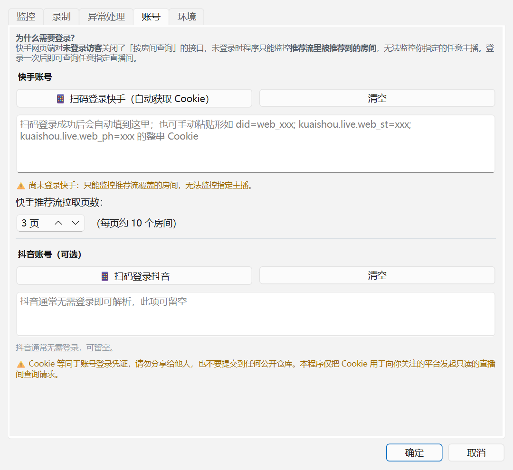

# LiveRecorder · 直播流自动录制工具

一款面向 Windows 桌面（预留 macOS 兼容）的**直播流自动监控与录制**工具，支持**快手**与**抖音**两大平台。  
按可配置间隔自动检测开播状态，检测到开播即以**原画画质**自动开始录制，下播后自动停止并**无损合并**分片。

> ⚠️ **免责声明**  
> 本工具仅供**个人学习、技术研究与离线备份**使用。  
> **严禁用于任何商业用途，严禁对录制内容进行二次分发或公开传播。**  
> 使用本工具产生的一切后果由使用者自行承担，请务必遵守各平台的服务条款及相关法律法规。  
> 请尊重内容创作者的合法权益。

> 📦 **本项目已并入「视频下载工具箱」作为模块 4（2026-09-23）。**
> 推荐入口：双击 `C:\Users\Mechrevo\Desktop\视频下载工具箱\启动工具箱.vbs`
> → 「▶ 直播录制器（图形窗口）」；也可直接用 `启动直播录制器.bat`。
> （`.vbs` 是零闪烁启动器；同目录的 `启动工具箱.bat` 功能相同，但会闪一下黑窗口，留着排错用。）
>
> 在工具箱内的差异只有三处：
> ① 解释器改用工具箱的 `runtime\live-recorder-env`（本目录的 `start.bat` / `login.bat` / `selftest.bat`
> 会按「工具箱 runtime → 本目录 `.venv` → PATH」顺序自动查找，无需改动用法）；
> ② 录像保存在工具箱内的 `downloads\live_recorder\`（可在「设置 → 录制」里改；该目录由配置项
> `save_path` 决定，已从旧的 `C:\Users\Mechrevo\LiveRecorder` 整体迁入）；
> ③ 免安装依赖已随工具箱交付，**不需要再执行 `setup.bat` 与 `pip install`**。
>
> 本文档保留原项目的完整说明（含独立部署方式），与工具箱内的实际使用完全兼容。

---

## 目录

- [功能特性](#功能特性)
- [环境要求](#环境要求)
- [安装步骤](#安装步骤)
- [快速开始](#快速开始)
- [使用说明](#使用说明)
- [文件组织与命名规则](#文件组织与命名规则)
- [配置说明](#配置说明)
- [常见问题（FAQ）](#常见问题faq)
- [打包为独立可执行文件](#打包为独立可执行文件)
- [项目结构](#项目结构)
- [架构说明](#架构说明)

---

## 功能特性

### 1. 直播状态自动监控

- **批量添加**监控对象：直接粘贴分享链接或房间号，支持一次粘贴数十条
- 快手 + 抖音合计支持 **50 个以上**监控对象（默认上限 100，可调）
- 轮询间隔可配置：**10 ~ 300 秒**，默认 60 秒
- 检测到**开播自动开始录制**，**下播自动停止**并收尾合并
- 支持启用/停用单个对象、立即手动检测

### 2. 原画画质流获取与录制

- 优先解析**原画（1080P 最高可用码率）**&#x7684; FLV / HLS 流地址
- 使用 ffmpeg `-c copy` **直接复制码流保存，全程不转码** —— 画质零损失、CPU 占用极低
- 原画获取失败时**自动降级**录制超清（720P），并在日志中明确记录降级事件
- 输出容器按流类型自动选择：FLV 流 → `.flv`，HLS 流 → `.ts`
- 支持录制完成后无损转封装为 MP4（同样 `-c copy`，不重编码）

### 3. 中断与异常处理

- 拉流中断或卡顿后按间隔（默认 **15 秒**）自动重连
- **重连成功后写入新的分片文件，已录内容绝不丢失**
- 下播后使用 ffmpeg concat **无损合并**所有分片为一个完整文件
- 单分片达到 **4GB** 或达到时长上限时自动分卷
- 三重合并降级策略：直接 concat → 时间戳归一化后 concat → TS 二进制拼接

### 4. 存储管理

- 保存路径可配置，按「**平台 / 主播昵称 / 日期**」三级目录自动组织
- 磁盘剩余空间低于阈值（默认 **10GB**）时**自动暂停全部录制任务并弹窗提醒**，空间恢复后自动继续
- 主播昵称自动清洗为合法文件名，避免特殊字符导致的路径错误

### 5. 界面与配置

- 主界面：直播间列表（平台、昵称、状态、已录时长、文件大小、分片数、当前文件）
- 完整的添加 / 删除 / 启停 / 设置操作
- 设置页：轮询间隔、保存路径、画质偏好、重连参数、分卷阈值、ffmpeg 路径等
- 配置持久化到本地 JSON，**重启后自动恢复监控任务**
- 实时日志窗口，记录检测、录制、降级、重连、合并等全部事件，支持**导出日志**

### 6. 质量与合规

- 随机化请求头 + 请求随机间隔 + 指数退避重试，降低触发风控的概率
- 各平台接口与解析逻辑**独立封装**，平台更新后只需修改单个模块
- 核心函数均附中文注释，代码严格按「平台解析层 / 监控调度层 / 录制层 / 界面层」划分

---

## 环境要求

| 项目     | 要求                                   |
| ------ | ------------------------------------ |
| 操作系统   | Windows 10 / 11（64 位）；架构已预留 macOS 兼容 |
| Python | **3.10 或更高**（推荐 3.11 ~ 3.13）         |
| ffmpeg | 必需，需为 **4.0+**（推荐 6.0+）              |
| 磁盘空间   | 建议预留 50GB 以上（直播录制体积较大）               |

---

## 安装步骤

### 第 1 步：安装 Python

前往 [python.org](https://www.python.org/downloads/) 下载 Python 3.10+ 安装包。

> **安装时务必勾选 `Add Python to PATH`**，否则命令行无法直接调用 `python`。

验证安装：

```bash
python --version
```

### 第 2 步：获取代码

把本项目文件夹放到任意目录，例如 `D:\Tools\live_recorder`。

### 第 3 步：安装 Python 依赖

#### 方式一：一键脚本（Windows 推荐）

直接双击项目根目录下的 **`setup.bat`**。脚本会自动完成：

1. 检查 Python 版本是否 ≥ 3.10
2. 在项目下创建独立虚拟环境 `.venv`（不会污染系统 Python）
3. 安装 `requirements.txt` 中的全部依赖
4. 校验 PyQt6 / httpx / requests 是否可用

看到「安装完成」后即可跳到第 4 步。

#### 方式二：手动命令行（macOS / Linux 或自定义环境）

```bash
cd D:\Tools\live_recorder

# 建议使用虚拟环境（推荐）
python -m venv .venv
.venv\Scripts\activate          # macOS / Linux: source .venv/bin/activate

pip install -r requirements.txt
```

> **虚拟环境的重要性**：`start.bat` 会优先使用项目下的 `.venv`，  
> 找不到时才回退到 PATH 中的 `python`。如果你在别处安装 PyQt6，  
> 启动时就会看到「未安装 PyQt6，请先执行：pip install -r requirements.txt」——  
> 这通常意味着启动用的解释器和你装依赖的解释器不是同一个。  
> 双击 `setup.bat` 即可彻底避免该问题。
>
> 网络较慢时可换国内镜像：
>
> ```bash
> pip install -r requirements.txt -i https://pypi.tuna.tsinghua.edu.cn/simple
> ```

### 第 4 步：安装 ffmpeg（关键步骤）

ffmpeg 是本工具的录制核心，**必须安装**。以下三种方式任选其一：

#### 方式一：下载后加入系统 PATH（推荐）

1. 访问 <https://www.gyan.dev/ffmpeg/builds/>，下载 **release-essentials** 版本（`ffmpeg-release-essentials.zip`）
2. 解压到固定目录，例如 `C:\ffmpeg`
3. 确认 `C:\ffmpeg\bin\ffmpeg.exe` 存在
4. 把 `C:\ffmpeg\bin` 添加到系统环境变量 **Path** 中：
   - `Win + R` → 输入 `sysdm.cpl` → 回车
   - 「高级」选项卡 → 「环境变量」
   - 在「系统变量」中找到 `Path` → 「编辑」→ 「新建」→ 填入 `C:\ffmpeg\bin`
   - 一路「确定」保存
5. **重新打开命令行**，验证：

```bash
ffmpeg -version
```

能输出版本信息即安装成功。

#### 方式二：放到项目 bin 目录（免配置）

在项目根目录下新建 `bin` 文件夹，把 `ffmpeg.exe`（及同目录的 `ffprobe.exe`）直接放进去：

```
live_recorder/
├── bin/
│   ├── ffmpeg.exe
│   └── ffprobe.exe
├── main.py
└── ...
```

程序会自动优先使用该文件，无需配置环境变量。

#### 方式三：在界面中手动指定路径

启动程序 → 「设置」→「环境」选项卡 → 在 **ffmpeg 路径** 中填写完整路径，例如：

```
C:\ffmpeg\bin\ffmpeg.exe
```

点击「检测」按钮确认可用即可。

> **提示**：建议同时安装 `ffprobe.exe`（与 ffmpeg 同一压缩包内），  
> 它用于校验合并后文件的时长，缺少它不影响录制与合并，只是会跳过时长校验。

### 第 5 步（可选）：安装 Playwright 以提升解析成功率

抖音的网页接口带有**动态签名参数**（`a_bogus` 等），纯 HTTP 请求可能被拦截。  
本工具已内置「真实浏览器兜底」方案，可在必要时启动无头浏览器直接抓取播放地址。

如需启用：

```bash
pip install playwright
playwright install chromium
```

> 不安装也可正常使用，只是在抖音接口签名校验严格时，解析成功率会有所下降。  
> 安装后可在「设置 → 环境」中控制是否启用。

### 第 6 步（快手必做）：登录快手，否则无法监控指定主播

**为什么必须做这一步？**

快手网页端对**未登录访客**关闭了「按房间查询」的接口，并且会以
「请求过快，请稍后重试」拦截自动化访问。实测结论：

| 访问方式                     | 结果       |
| ------------------------ | -------- |
| 纯 HTTP 调 `livedetail`     | 返回占位响应，无数据 |
| 无头 Chromium 打开直播间        | 被拦截      |
| 有头 Chromium 打开直播间        | 被拦截      |
| **有头真实 Chrome 打开直播间**     | **仍被拦截** |

三种浏览器都被拦截，说明这**不是浏览器指纹问题**，而是访客级别的访问限制。

因此未登录时，程序只能监控**推荐流里被推荐到的房间**（每页约 10 个，可在设置中调整页数）。
如果你要监控的是**自己指定的主播**，必须让程序带上登录凭证。

**操作（只需一次），三种方式任选**：

**方式一：在程序内扫码（最省事，推荐）**

1. 启动程序，点击工具栏的 **「扫码登录」** → 选「扫码登录快手（推荐）」；
2. 对话框里会**直接显示二维码**，用手机快手 App 扫一扫并确认；
3. 登录成功后凭证自动保存，对话框自动关闭。

也可以走「**设置 → 账号** → 📱 扫码登录快手（自动获取 Cookie）」，效果完全一样。


> 扫码时会另外打开一个小浏览器窗口，**两处二维码是同一张**，扫任意一处都可以。
> 二维码过期会自动刷新（刷新后需要重新扫新的一张）。

**方式二：双击 `login.bat`**

双击后浏览器自动打开登录页并弹出二维码，扫码完成即写入 `config.json`。

**方式三：命令行**

```bash
python login.py            # 快手、抖音依次登录（打开浏览器扫码）
python login.py kuaishou   # 只登录快手
```

> 也可以手动获取：浏览器登录 `live.kuaishou.com` → 点右上角「登录」→ `F12` → 网络 →
> 刷新 → 点任意请求 → 复制请求标头里 `Cookie` 的完整值 → 粘贴到「设置 → 账号」。
>
> ⚠️ Cookie 等同于账号登录凭证，请勿分享或提交到公开仓库。程序只用它向你关注的
> 平台发起**只读**的直播间查询请求。

### 第 7 步：自检

运行内置自检，确认环境无误：

```bash
python --selftest
```

输出全部 `✔` 即表示环境就绪。也可以运行完整冒烟测试，验证录制链路：

```bash
python smoke_test.py
```

> 冒烟测试完全在本地执行（含本地 HTTP 服务模拟直播流），**不会访问任何第三方平台**，可安全反复运行。

若怀疑「录不上」是平台接口变更导致的，再运行**真实链路自检**：

```bash
python e2e_check.py            # 完整自检（含真实录制约 20 秒）
python e2e_check.py --quick    # 只验证解析 / 开播状态 / 取流，不录制
```

> `e2e_check.py` 会**真实访问抖音与快手**，并短暂拉流录制，用于判断问题出在平台侧  
> 还是程序侧。它不会高频请求，但请勿反复连续执行（有触发风控的风险）。  
> 两个脚本的分工：`smoke_test.py` 验证本地录制链路，`e2e_check.py` 验证平台解析层。

---

## 快速开始

**Windows（推荐）**：双击 `setup.bat` 配置环境 → 双击 `start.bat` 启动界面。

**命令行**：

```bash
python main.py
```

程序启动后：

1. 点击工具栏 **「添加直播间」**
2. 在文本框中粘贴分享链接或房间号，**每行一条**：
   ```
   https://live.douyin.com/123456789
   https://v.kuaishou.com/abcdEF
   123456789
   ```
3. 选择平台（含链接的可保持「自动识别」，纯数字建议手动指定）
4. 点击 **「添加」**
5. 点击 **「▶ 开始监控」**

之后程序会自动轮询、自动录制、自动合并，全程无需人工干预。

---

## 使用说明

### 主界面

| 区域  | 说明                                              |
| --- | ----------------------------------------------- |
| 工具栏 | 添加 / 删除 / 开始监控 / 停止监控 / 立即检测 / 设置 / 打开目录 / 导出日志 |
| 列表区 | 每个监控对象的实时状态、已录时长、文件大小、分片数、当前文件                  |
| 日志区 | 实时滚动输出全部运行事件，支持按级别过滤与导出                         |
| 状态栏 | 监控状态、对象数、正在录制数、磁盘剩余空间                           |

### 支持的输入格式

**抖音**

- 直播间地址：`https://live.douyin.com/123456789`
- 分享短链：`https://v.douyin.com/xxxxx/`
- 纯房间号：`123456789`

**快手**

- 直播间地址：`https://live.kuaishou.com/u/3xf8dh7tqmd9bps`
- 分享短链：`https://v.kuaishou.com/xxxxx`
- 纯用户 ID：`3xf8dh7tqmd9bps`

> 也可以直接粘贴**整段分享口令**（如「复制打开快手，看看xxx的直播…」），程序会自动从中提取链接。

### 状态说明

| 状态  | 含义                   |
| --- | -------------------- |
| 待解析 | 已添加，等待首次解析（短链需跟随重定向） |
| 未开播 | 已确认主播未开播             |
| 已开播 | 检测到开播，正在排队或准备录制      |
| 录制中 | 正在录制（绿色加粗显示）         |
| 重连中 | 拉流中断，正在按间隔重连         |
| 合并中 | 直播已结束，正在合并分片         |
| 已暂停 | 磁盘空间不足，已全局暂停         |
| 异常  | 解析或录制出错（鼠标悬停可查看原因）   |
| 已停用 | 用户手动停用了该对象           |

### 右键菜单

在列表行上右键可快速执行：复制原始输入、打开录制目录、停止该房间录制、启用/停用、删除。

### 快捷键

| 快捷键        | 功能    |
| ---------- | ----- |
| `Ctrl + N` | 添加直播间 |
| `Delete`   | 删除选中  |
| `F5`       | 开始监控  |
| `F6`       | 停止监控  |
| `F7`       | 立即检测  |
| `Ctrl + ,` | 打开设置  |
| `Ctrl + E` | 导出日志  |
| `F1`       | 使用说明  |

---

## 文件组织与命名规则

### 目录结构

```
<保存路径>/
└── 抖音/                              ← 平台
    └── 某某主播/                       ← 主播昵称
        └── 2026-09-23/                ← 日期
            ├── 抖音_某某主播_20260923_141530_001.flv    ← 分片 1
            ├── 抖音_某某主播_20260923_141530_002.flv    ← 分片 2（重连/分卷产生）
            ├── 抖音_某某主播_20260923_141530_merged.flv ← 无损合并后的完整文件
            └── 抖音_某某主播_20260923_141530_merged.mp4 ← 可选：转封装为 MP4
```

### 命名规则

```
{平台}_{主播昵称}_{YYYYMMDD_HHMMSS}_{分段序号}.{容器}
```

- `平台`：抖音 / 快手
- `主播昵称`：自动清洗非法字符
- `YYYYMMDD_HHMMSS`：**本场直播的起始时间**，同一场直播的所有分片共用，便于归组
- `分段序号`：3 位数字，从 `001` 开始
- `容器`：FLV 流为 `flv`，HLS 流为 `ts`

**合并完成后，原始分片会自动清理**，只保留合并后的完整文件（`_merged` 后缀）。  
若只有 1 个分片，则不产生合并文件，也不重命名，直接保留原分片命名。

---

## 配置说明

配置保存在项目根目录的 `config.json`，程序退出时自动写入，重启时自动恢复。

| 配置项                         | 默认值              | 说明                           |
| --------------------------- | ---------------- | ---------------------------- |
| `poll_interval`             | `60`             | 轮询间隔（秒），10 ~ 300             |
| `check_concurrency`         | `6`              | 并发检测线程数，过高易触发风控              |
| `max_monitor_rooms`         | `100`            | 监控对象上限（≥ 50）                 |
| `save_path`                 | `~/LiveRecorder` | 录制文件保存根目录。**工具箱内已设为 `downloads\live_recorder`** |
| `quality_preference`        | `origin`         | 画质偏好：`origin` 原画 / `high` 超清 |
| `enable_fallback`           | `true`           | 原画失败时是否自动降级                  |
| `max_file_size_gb`          | `4.0`            | 单分片大小上限（GB），达到后分卷            |
| `max_duration_minutes`      | `0`              | 单分片时长上限（分钟），0 表示不限           |
| `max_concurrent_recordings` | `8`              | 同时录制数上限                      |
| `reconnect_interval`        | `15`             | 拉流中断后的重连间隔（秒）                |
| `stall_timeout`             | `25`             | 输出文件多久无增长即判定为卡顿（秒）           |
| `max_reconnect_attempts`    | `0`              | 最大连续重连次数，0 表示无限重连            |
| `min_free_disk_gb`          | `10.0`           | 磁盘剩余下限（GB），低于此值暂停全部录制        |
| `convert_to_mp4`            | `false`          | 录制完成后转封装为 MP4（不重编码）          |
| `ffmpeg_path`               | `ffmpeg`         | ffmpeg 可执行文件路径               |
| `playwright_enabled`        | `true`           | 是否允许浏览器兜底解析                  |
| `headless_browser`          | `true`           | 浏览器是否无头运行                    |
| `auto_start_monitor`        | `false`          | 启动程序后是否自动恢复监控                |

> 大部分配置项都可在界面「设置」中图形化调整，无需手动编辑 JSON。  
> 高级设置（如 `check_concurrency`）也可直接编辑 `config.json`。

---

## 常见问题（FAQ）

### Q1：启动时提示「未检测到可用的 ffmpeg」怎么办？

说明 ffmpeg 未安装或未加入 PATH。请参照 [第 4 步](#第-4-步安装-ffmpeg关键步骤) 重新配置。  
最快的验证方式：打开命令行执行 `ffmpeg -version`，能输出版本信息即为正常。  
也可以直接把 `ffmpeg.exe` 放进项目下的 `bin/` 目录，或是在「设置 → 环境」中指定完整路径。

### Q2：一直显示「未开播」，但主播确实在直播？

**如果状态说明里写的是「被快手风控拦截」**，那么这不是「未开播」，而是快手对
未登录访客的访问限制（详见 [第 6 步](#第-6-步快手必做登录快手否则无法监控指定主播)）。
解决方式是双击 `login.bat` 完成登录。

否则按以下顺序排查：

1. **房间号解析有误** —— 用浏览器打开该直播间，确认地址栏中的房间号与程序中显示的一致
2. **触发了平台风控** —— 把轮询间隔调大（如 120 ~ 180 秒），并适当降低并发检测数
3. **平台接口已变更** —— 请参考 [平台接口维护](#平台接口维护) 更新对应模块
4. **网络环境问题** —— 尝试切换网络，或确认是否需要代理

> 程序会把「为什么没录上」写进日志与列表的**状态说明**列，例如  
> 「被快手风控拦截（页面提示「请求过快」或出现验证码）」「触发风控：…」  
> 「房间不可观看：该内容暂时无法查看」「未开播（浏览器未捕获到直播流）」。  
> 先看这条说明，通常能直接定位到上面哪一类原因。  
> 特别注意：程序**不会**把风控误报成「未开播」——如果你看到「未开播」，
> 那确实是检测到未开播。

### Q3：录制失败 / 提示「无法获取任何可用流地址」？

1. 确认该直播间确实在开播（**推荐流 / 榜单列表会滞后**，列表显示在播不代表此刻真在播）
2. **快手**：先跑 `login.bat` 登录。未登录时快手只放行「推荐流里被推到的房间」，
   你指定的主播若不在其中，就会取流失败
3. 抖音接口带动态签名，建议安装 Playwright（见 [第 5 步](#第-5-步可选安装-playwright-以提升解析成功率)）
4. 检查日志窗口中的详细错误信息（可通过「显示调试」查看 DEBUG 级日志）
5. 直播刚开播的前几十秒可能还没有生成流地址，稍等一个轮询周期即可
6. 运行 `python e2e_check.py --quick`，它会直接告诉你当前是解析、状态还是取流环节出的问题

### Q4：为什么录制文件有多个分片？

分片是**正常设计**，用于保证录制稳定性：

- **拉流中断重连**时会写入新分片（避免损坏已有文件）
- **单文件达到 4GB 或时长上限**时自动分卷
- 直播结束时，所有分片会**自动无损合并**为一个完整文件，原始分片自动清理

所以最终只会看到 `_merged.flv`（或 `.mp4`）一个文件。

### Q5：合并后的文件时长看起来不对？

程序内置时长校验：合并后会比对成品时长与各分片时长总和。  
若偏差较大，会自动改用「逐段归一化时间戳后重新合并」的方式（该问题通常由分片起始时间戳未归零引起）。  
若问题依旧，请查看日志中的 `合并` 相关记录，并保留原始分片以便排查。

### Q6：提示「磁盘空间不足，已暂停全部录制」？

当保存盘剩余空间低于设定阈值（默认 10GB）时，程序会暂停全部录制并弹窗提醒，  
同时在状态栏显示「已暂停」。  
**清理磁盘后无需手动操作**，空间恢复到「阈值 + 2GB」以上时会自动继续监控。

### Q7：如何调整录制画质？

「设置 → 录制 → 画质偏好」：

- **原画优先**：优先选择 1080P 最高码率的流（默认）
- **超清优先**：优先选择 720P 的流，更省带宽和磁盘

注意：本工具**不做转码**，只是选择不同的源流地址。实际可用画质取决于主播的推流设置。

### Q8：录制文件能用普通播放器打开吗？

可以。`.flv` 和 `.ts` 都是标准容器格式：

- **推荐播放器**：PotPlayer、VLC、MPV
- Windows 自带播放器可能不支持 FLV，建议安装上述播放器
- 如需 MP4，可在设置中开启「录制完成后转封装为 MP4」，或事后手动执行：
  ```bash
  ffmpeg -i input.flv -c copy -movflags +faststart output.mp4
  ```

### Q9：监控 50 个直播间会不会触发风控？

程序已内置多重防护：随机 User-Agent、请求间隔抖动、指数退避、并发限制。  
但**仍需合理配置**：

- 监控对象较多时，把轮询间隔调到 **120 ~ 180 秒**
- 并发检测数保持在 **4 ~ 8** 之间
- 不建议在短时间内反复添加/删除大量对象

### Q10：配置保存在哪里？如何备份？

配置在项目根目录的 `config.json` 中（包含全部设置与监控清单）。  
直接复制该文件即可完成备份/迁移。也可通过环境变量 `LIVE_RECORDER_CONFIG` 指定其他路径。

### Q11：启动时提示「未安装 PyQt6，请先执行：pip install -r requirements.txt」？

这是**解释器不一致**导致的：你在 A 环境装了依赖，启动时用的却是 B 解释器。

排查步骤：

```bash
# 1. 看看启动实际用的是哪个 Python
#    有 .venv 时 start.bat 会用它，否则用 PATH 中的 python
python -c "import sys; print(sys.executable)"

# 2. 直接验证该解释器里有没有 PyQt6
python -c "import PyQt6.QtCore as c; print('PyQt6', c.PYQT_VERSION_STR)"

# 3. 给它补装依赖（或直接双击 setup.bat）
python -m pip install -r requirements.txt
```

**最省事的做法**：双击 `setup.bat`。它会在项目下建好 `.venv` 并装齐依赖，  
`start.bat` 会自动优先使用这个 `.venv`，从此不再出现该提示。

常见诱因：系统里装了多个 Python（如 Microsoft Store 版、conda、各类工具自带的 Python），  
`pip` 与 `python` 指向了不同解释器。用 `pip -V` 和 `python -V` 对比路径即可确认。


### Q12：抖音明明在直播，日志却说「平台返回空响应」？

这是**缺少首访 Cookie**，不是风控。抖音 `webcast/room/web/enter/` 接口必须携带  
首次访问 `https://live.douyin.com/` 时下发的 `ttwid`，否则会稳定返回  
「HTTP 200 + 空响应体」。

程序已自动处理：检测到空响应时会强制补抓一次首页 Cookie 并重试。  
如果仍然出现，通常是对 `live.douyin.com` 的访问被网络环境拦截（如公司网络/代理），  
用浏览器打开 `https://live.douyin.com/` 验证一下即可确认。

> 实现细节见 `platforms/douyin.py` 的 `_ensure_cookies`：  
> 判断 Cookie 是否就绪时**必须校验域名**——分享页 `webcast.amemv.com` 会写入  
> 一个同名但不同域的 `ttwid`，它不会随请求发往 `live.douyin.com`，  
> 只按「CookieJar 里存在 ttwid」判断会被它骗过。

### Q13：会不会录到别的直播间的内容？

不会。这是一个已经识别并加固过的风险点：

- **抖音**：主播下播后，直播间页面会**自动播放「推荐直播」**。若此时用浏览器兜底
  去抓播放地址，抓到的其实是**另一个房间**的流——录错房间比录不上更糟。
- **快手**：被风控拦截时页面同样会播放**推荐位**内容。实测请求房间 A 时，页面
  自动跳转到了房间 B 并播放了 B 的流。

程序从三处阻断这条路径：

1. 取流前先判开播状态：房间已下播时直接判定为「房间不可用」，**不再降级、不再走浏览器兜底**；
2. 浏览器兜底返回前校验页面最终地址：若落地到别的房间号，直接丢弃抓取结果；
3. **快手**额外识别风控页面（「请求过快」/验证码 / 跳转验证域名）：一旦识别，
   本轮抓到的任何地址都不采信。

> 对应代码：`platforms/douyin.py` 的 `fetch_stream` 与 `capture_stream_via_browser`、  
> `platforms/kuaishou.py` 的 `probe_stream_via_browser`、  
> `platforms/playwright_helper.py` 的 `_detect_blocked()` / `final_url()`。  
> 回归验证项见 `e2e_check.py` 的「下播房间取流直接判定不可用」。

### Q14：播放器里看不到时长 / 显示 0:00？

直播流录制出的 FLV **通常不写 `duration` 元数据**（`-c copy` 全程不重新封装媒体信息），  
因此部分播放器会把时长显示为 0 或需要拖动进度条后才刷新。这不是文件损坏——  
可直接拖到中间播放验证内容正常。程序内部判断时长时会自动改用「完整解码」的方式。

若需要时长信息完整的文件，把「录制完成后转封装为 MP4」打开即可：  
MP4 容器会写入完整时长索引（仍是 `-c copy` 无损转换，不重新编码）。

### Q15：快手为什么只能录到「推荐流里的房间」？

因为快手把「按房间查询」的接口对**未登录访客**关掉了，并且用「请求过快」拦截
自动化访问（无头/有头浏览器、真实 Chrome 三种方式实测都被拦截）。目前唯一仍然
可用的入口是**推荐流接口**，它能一次返回约 10 个在播房间的完整流地址。

**表现**：程序可以正常录制推荐流里出现的房间（每个房间都能拿到原画 FLV 并录制成功），
但你指定的主播如果不在推荐流里，就会提示「被快手风控拦截」。

**解决**：点工具栏「扫码登录」或双击 `login.bat` 登录一次。带上登录凭证后，
访客限制不再适用，即可监控任意指定主播。

**提高命中率的临时办法**：在「设置 → 账号」里把**推荐流拉取页数**调大
（默认 3 页 ≈ 30 个房间，最多 10 页）。页数越多覆盖越广，但每个轮询周期
会多出相应次数的请求。

### Q16：「快手扫码登录」在哪里？打开后没看到二维码？

v1.0.3 起有两个入口：

| 入口                    | 路径                                       |
| --------------------- | ---------------------------------------- |
| **主工具栏**（最快）         | 启动程序 → 点工具栏 **「扫码登录」** → 选「扫码登录快手（推荐）」  |
| **设置页**               | 「设置 → 账号」→ 📱 扫码登录快手（自动获取 Cookie）        |
| 不想开界面                 | 双击项目目录下的 `login.bat`                     |



如果你的旧版本**只打开了浏览器却看不到二维码**：那是 v1.0.2 的缺陷——它只打开了
`live.kuaishou.com` 首页就干等，而**快手首页不会自动弹二维码**，必须先点右上角的
「登录」才会出现扫码弹窗。v1.0.3 已修复：现在会自动点开登录弹窗、把二维码直接显示在
对话框里，并在过期时自动刷新。

若仍然没有二维码，按顺序检查：

1. 浏览器窗口是否被其它窗口挡住（二维码也在浏览器里，两处是同一张）；
2. 是否提示浏览器内核缺失 —— 执行 `playwright install chromium`；
3. 页面是否加载失败 —— 在弹出的浏览器窗口里按 `F5` 刷新一次；
4. 仍不行就走「手动获取」：浏览器登录 `live.kuaishou.com` → `F12` → 网络 → 刷新 →
   复制请求标头里 `Cookie` 的完整值 → 粘贴到「设置 → 账号」的输入框。

### 平台接口维护

平台的接口地址与字段结构可能随版本更新而变化。本工具已把平台差异**完全隔离**在独立模块中，  
接口变更时只需修改对应文件：

| 平台 | 文件                      | 需要关注的常量 / 方法                                                                                                                    |
| -- | ----------------------- | ------------------------------------------------------------------------------------------------------------------------------- |
| 抖音 | `platforms/douyin.py`   | `WEB_ENTER_API`、`REFLOW_API`、`ENTER_BASE_PARAMS`、`_web_rid_from_room_id`、`_ensure_cookies`、`_fill_room_info`、`_pick_by_quality` |
| 快手 | `platforms/kuaishou.py` | `RECO_API`、`DETAIL_API`、`_load_reco_index`、`_reco_entry_to_info`、`_collect_stream_candidates`、`probe_stream_via_browser`        |

**排查建议**：

1. 用浏览器打开直播间，按 `F12` → 「网络」面板，筛选 `enter` 或 `reco` 找到实际请求
2. 对比请求参数与响应结构，更新对应常量或解析路径
3. 快手采用**递归收集流地址**的策略，schema 微调通常无需改代码
4. 抖音若出现签名校验拦截，`playwright_helper.py` 可绕过签名直接抓取播放地址

**调试用接口**：抖音的 `https://live.douyin.com/webcast/feed/` 会返回一批在播房间  
（含 `share_url` 与各自的 `flv_pull_url`），无需登录即可访问，用于快速拿到测试样本。

**抖音已确认的两个接口特性**（排查时最容易踩）：

| 现象                                            | 真实原因                                       | 处理位置                                      |
| --------------------------------------------- | ------------------------------------------ | ----------------------------------------- |
| `enter` 返回「HTTP 200 + 空响应体」                   | 缺少 `live.douyin.com` 主域的 `ttwid`（**不是风控**） | `_ensure_cookies` / `_fetch_room_payload` |
| `enter` 固定返回 `status_code=4001038`「该内容暂时无法查看」 | 把 19 位 `room_id` 当成了 `web_rid` 传参          | `_coerce_rid` / `_web_rid_from_room_id`   |

**快手已确认的四个接口特性**（排查时最容易踩）：

| 现象                                                     | 真实原因                                                          | 处理位置                                                     |
| ------------------------------------------------------ | ------------------------------------------------------------- | -------------------------------------------------------- |
| `livedetail` 对任意房间号都返回同一份约 700 字节响应                     | 接口对**未登录访客**已失效（注意：**在播房间也一样**，不要误判为「未开播」）                     | `_mark_api_degraded` / `_load_reco_index`                |
| 分享链解析出的房间号永远是同一个人（分享者）                                 | 误用了重定向参数 `efid`——它是**分享者** ID，只有路径 `/u/<id>` 才是主播 ID         | `resolve_room`                                           |
| 浏览器打开直播间显示「请求过快，请稍后重试」                                 | 访客级别的访问限制，**换浏览器无效**；且此时页面可能自动播放**推荐位**内容，会「录到别人的直播」         | `_detect_blocked` + 落地校验；根治手段是登录（`login.bat`）           |
| `reco` 推荐流是唯一仍可用的批量取流入口（支持 `page` 翻页与 `categoryId` 过滤） | 其它候选（`liveroom/info`、`websocketinfo`、`search/*`、`profile/public`）均已失效或返回空 | `_load_reco_index` / `_fetch_reco_pages`                 |

> **快手的正确使用方式**：先跑一次 `login.bat` 登录。未登录时程序只能监控推荐流里
> 出现的房间；登录后可监控任意指定主播。

---

## 打包为独立可执行文件

如需分发给不使用 Python 的机器，可用 PyInstaller 打包：

```bash
pip install pyinstaller

pyinstaller --noconsole --name LiveRecorder ^
    --add-data "platforms;platforms" ^
    main.py
```

打包产物在 `dist/LiveRecorder/` 目录。使用时把 `ffmpeg.exe` 放进同级的 `bin/` 目录即可。

> 注意：打包后 `config.json` 会生成在可执行文件同级目录；  
> 若遇到 ffmpeg 找不到的问题，优先使用「方式二：放到项目 bin 目录」。

---

## 项目结构

```
live_recorder/
├── main.py                    # 程序入口（GUI 启动 / 环境自检）
├── smoke_test.py              # 冒烟测试：本地验证录制、分片、合并、转封装全链路
├── e2e_check.py               # 真实链路自检：访问真实平台验证解析/状态/取流/录制
├── requirements.txt           # Python 依赖
├── setup.bat                  # 一键配置环境（建 .venv + 装依赖 + 校验）
├── start.bat                  # 一键启动界面（自动选择 .venv）
├── login.bat                  # 一键登录快手/抖音（扫码，写入 Cookie）
├── login.py                   # 登录助手入口（命令行用法同 login.bat）
├── selftest.bat               # 一键环境自检
├── README.md                  # 本文档
├── ARCHITECTURE.md            # 架构说明文档
├── docs/                      # 文档配图（扫码登录对话框、账号设置页）
├── config.json                # 配置持久化文件（首次运行后生成）
├── .venv/                     # 虚拟环境（由 setup.bat 生成，不纳入版本控制）
│
├── config/                    # 配置管理
│   └── settings.py            # AppConfig / RoomEntry / ConfigStore
│
├── platforms/                 # ① 平台解析层
│   ├── base.py                # 抽象基类与数据模型
│   ├── kuaishou.py            # 快手解析器（推荐流索引 + 浏览器兜底）
│   ├── douyin.py              # 抖音解析器
│   ├── playwright_helper.py   # 浏览器兜底（抓播放地址、风控与落地校验）
│   ├── login_helper.py        # 命令行登录助手（扫码后导出 Cookie）
│   ├── qr_login.py            # 扫码登录会话：点出登录弹窗 + 定位二维码 + 轮询登录态
│   ├── registry.py            # 平台注册表 + 三级降级取流入口
│   └── utils.py               # 随机请求头、节流、URL 工具
│
├── core/                      # ② 监控调度层
│   ├── monitor.py             # MonitorEngine：轮询调度与任务编排
│   └── events.py              # EventBus 事件总线
│
├── recorder/                  # ③ 录制层
│   ├── ffmpeg_recorder.py     # StreamRecorder：拉流、分片、重连、收尾
│   ├── merger.py              # 三级无损合并 + MP4 转封装
│   ├── storage.py             # 目录组织、文件名生成、磁盘检查
│   └── ffmpeg_utils.py        # ffmpeg 调用、版本检测、时长探测
│
├── ui/                        # ④ 界面层
│   ├── main_window.py         # 主窗口
│   ├── add_room_dialog.py     # 添加直播间（支持批量）
│   ├── login_dialog.py        # 扫码登录对话框（二维码内嵌显示 + 后台线程）
│   ├── settings_dialog.py     # 设置面板
│   └── log_panel.py           # 日志窗口
│
└── utils/                     # 通用工具
    └── logger.py              # 日志系统（缓冲区 + 文件 + 订阅）
```

---

## 架构说明

各模块的职责划分与数据流转方式详见 **[ARCHITECTURE.md](ARCHITECTURE.md)**。

简要概览：

```
              ┌─────────────────────────────────────┐
              │           界面层 (ui/)              │
              │  主窗口 · 列表 · 设置 · 日志窗口     │
              └───────────▲──────────┬──────────────┘
                          │ 事件      │ 用户操作
                          │ 快照      ▼
              ┌───────────┴─────────────────────────┐
              │      监控调度层 (core/)              │
              │  MonitorEngine · EventBus            │
              │  轮询检测 → 决策 → 派遣录制任务       │
              └───────┬──────────────┬───────────────┘
                      │ 取流         │ 录制
                      ▼              ▼
        ┌──────────────────┐  ┌──────────────────────┐
        │ 平台解析层        │  │   录制层 (recorder/) │
        │ (platforms/)      │  │  StreamRecorder      │
        │  快手 / 抖音      │  │  ffmpeg -c copy       │
        │  原画地址解析      │  │  分片 / 重连 / 合并   │
        └──────────────────┘  └──────────────────────┘
                      │              │
                      └──────┬───────┘
                             ▼
                    外部依赖：ffmpeg · httpx · Playwright
```

**核心设计原则**：平台差异隔离在解析层，录制与调度完全不感知平台细节；  
业务层不依赖任何 GUI 组件，通过 `EventBus` 与日志缓冲区单向通知界面，  
因此核心逻辑可独立测试（`smoke_test.py` 即为此设计的直接受益者）。

---

## 更新记录

### v1.0.3 —— 修复「没看见快手扫码获取 cookies」

v1.0.2 引入的 `login.bat` **只打开了 `live.kuaishou.com` 首页就干等**，而快手首页
**不会自动弹出二维码**——必须先点右上角的「登录」，才会出现「快手APP登录 / 手机号登录」
弹窗，二维码在弹窗里。用户因此反馈「没看见快手扫码获取 cookies」。

| 问题现象                            | 根因                                                     | 修复                                                                       |
| ------------------------------- | ------------------------------------------------------ | ------------------------------------------------------------------------ |
| 打开 `login.bat` 后浏览器里没有二维码       | 只 `goto` 了首页，从未点击「登录」入口，扫码弹窗根本没被打开                      | 新增 `platforms/qr_login.py`：打开页面 → **自动点出登录弹窗** → 定位二维码 → 轮询登录态 → 导出 Cookie |
| 程序里找不到「扫码登录」这个功能                | 登录功能只有一个 `login.bat`，界面里什么都没有，无从发现                     | **主工具栏新增「扫码登录」**（菜单选快手/抖音）；「设置 → 账号」新增 📱 扫码登录按钮                        |
| 用户得在浏览器和程序之间来回找二维码                | 二维码只存在于浏览器窗口里                                          | 二维码**直接抓取并显示在对话框内**，过期自动刷新；两处二维码同源，扫哪张都行                                  |
| 命令行登录体验差                        | 无进度提示，只有一段静态文字                                          | `login.py` 现在会打印进度、二维码提示、剩余秒数，并在超时时给出可操作建议                               |

同时改进：

- 新增 `ui/login_dialog.py`：扫码对话框（后台线程跑 Playwright，主线程只更新界面）
- 登录成功后凭证自动写回 `config.json`，无需手工复制粘贴
- 账号页新增「清空」按钮与实时状态提示（未登录时明确告知「只能监控推荐流覆盖的房间」）
- 「设置 → 账号」内容放入滚动区，小窗口下不再被挤扁
- `e2e_check.py` 新增 C 段（登录入口→二维码，无头验证）与 D 段（界面入口验证），  
  并支持 `--only login` / `--only ui` 单独运行；当前 **24/24 通过**

**使用提示**：启动程序后点工具栏「扫码登录」，或双击 `login.bat`。抖音无需登录。

### v1.0.2 —— 修复「快手还是不能录制」

v1.0.1 之后快手仍无法录制。经逐层实测，定位到 3 个独立问题：

| 问题现象                                              | 根因                                                                                                                    | 修复                                                                              |
| ------------------------------------------------- | --------------------------------------------------------------------------------------------------------------------- | ------------------------------------------------------------------------------- |
| 快手所有房间都取不到流，且**分享链解析出的永远是同一个人**                   | 重定向地址里的 `efid` 是**分享者** ID（同一人分享不同主播时保持一致），而代码把它当成了主播 ID。路径 `/u/<id>` 里才是主播 ID                                         | `resolve_room` 改为「路径 `/u/<id>` → 查询参数 `principalId` → `/fw/live/<id>`」，**彻底不用 `efid`** |
| 直播间明明在播，程序却显示「未开播」                                | 未被登录时页面会返回「请求过快，请稍后重试」，`_check_via_browser` 把「没抓到流」一律判为 `OFFLINE`                                                  | 新增风控识别：命中「请求过快/验证码/验证域名」时判为 `UNKNOWN` 并给出可操作提示，不再误报「未开播」                       |
| 快手取流完全不可用（连推荐流也没用上）                               | `livedetail` / `profile/public` / `websocketinfo` / `search/*` 对未登录访客全部失效，此前只把浏览器当唯一出路                                 | **改用 `liveroom/reco` 推荐流作为首选数据源**：一次返回在播房间的完整流地址，支持翻页与 `categoryId`，命中时无需启动浏览器 |
| 存在「录到别人直播间」的风险                                    | 被风控的页面会自动播放**推荐位**内容。实测请求房间 A 时页面跳转到了房间 B 并播放了 B 的流                                                                    | 浏览器兜底增加**落地校验**（页面最终地址必须仍属目标房间）与**风控拦截**判定，任一不通过即丢弃结果                          |
| 无法监控任意指定主播                                        | 快手对**未登录访客**关闭了按房间查询的接口，且「请求过快」拦截与浏览器种类无关（无头 Chromium / 有头 Chromium / 有头真实 Chrome 实测全部被拦）                              | 新增**扫码登录助手**（`login.bat` / `login.py`）：登录一次后即可监控任意主播；「设置 → 账号」也支持手动粘贴 Cookie      |

同时改进：

- 新增「设置 → 账号」页：快手/抖音 Cookie、推荐流拉取页数
- 推荐流索引对所有房间共用并带 TTL，监控多个房间时开销可忽略
- 快手流地址的 `qualityType` 现在映射为「原画/超清/高清/标清」等可读文案
- `e2e_check.py` 增加快手端到端验证（含真实录制），当前 **21/21 通过**

**使用提示**：快手用户请先跑一次 `login.bat`；抖音无需登录。

### v1.0.1 —— 修复「全部录制失败」

针对抖音、快手两个平台在接口层面暴露出的问题，逐项定位并修复：

| 问题现象                                     | 根因                                                                             | 修复                                                                                                                   |
| ---------------------------------------- | ------------------------------------------------------------------------------ | -------------------------------------------------------------------------------------------------------------------- |
| 抖音所有房间均取流失败，固定报「该内容暂时无法查看」               | 分享链接只能解析出 19 位 `room_id`，被当成了 `web_rid` 传给 `enter` 接口                          | 新增 `_web_rid_from_room_id` / `_coerce_rid`，解析分享页内嵌的 `webRid` 完成换算；`check_live` / `fetch_stream` 入口也做归一化，历史配置中的旧值同样可用 |
| 抖音 `enter` 接口返回「HTTP 200 + 空响应体」，日志误报为风控 | 接口必须携带 `live.douyin.com` **主域**的 `ttwid`；而分享页会先写入一个同名不同域的 `ttwid`，导致「已就绪」判断被欺骗 | `_ensure_cookies` 改为按域后缀校验 Cookie；新增 `EmptyResponseError`，命中时强制补抓首访 Cookie 并重试一次                                     |
| 抖音响应是乱码，正则什么都匹配不到                        | 请求头声明了 `Accept-Encoding: br`，但环境缺少 Brotli 解码器，httpx 把压缩字节当文本返回且不报错             | 仅在解码器可用时才声明 `br`；`requirements.txt` 增加 `brotli`                                                                      |
| 快手所有房间都被判为「已开播」，无限重连空转                   | `is_living = bool(playUrls)`：未开播时接口仍返回 `{"h264":{},"hevc":{}}`，非空字典恒为真         | 改为「显式开播标志优先，其次判断是否存在真实流地址」                                                                                           |
| 快手完全取不到状态与流地址                            | `live_api/liveroom/livedetail` 已失效，对任意房间号都返回同一份占位响应                            | 自动识别并标记接口失效（只告警一次），改用浏览器兜底；结果缓存并纳入轮询耗时考量                                                                             |
| 有概率**录到别的直播间**的内容                        | 房间下播后，抖音页面会自动播放「推荐直播」，浏览器兜底会抓到该推荐流的地址                                          | 双闸门：① `fetch_stream` 先判开播状态，不可用即抛 `RoomUnavailableError`，不再降级/兜底；② 浏览器兜底校验页面落地房间号，不一致则丢弃                             |
| 风控被反复重试，越试封得越久                           | 403/429/444 与空响应都走了指数退避重试                                                      | 新增 `RiskControlError`（不重试）与 `EmptyResponseError`（仅补 Cookie 后重试一次）                                                    |
| 每个请求随机 UA，反而更像自动化                        | Cookie 与 UA 不匹配                                                                | 改为**会话级固定指纹**（`random_profile()`，整个会话复用一套 UA / Accept-Language）                                                      |
| 界面只显示「状态未知」，看不出为什么没录上                    | 失败原因在多层传递中被吞掉                                                                  | `RoomInfo.note` 贯通到日志与列表「状态说明」列；`resolve_stream` 聚合末次失败原因一并抛出                                                        |
| 自检会覆盖用户已保存的监控清单                          | `--selftest` 直接对真实 `config.json` 执行了 `save()`                                  | 改为在临时文件上验证读写，自检不再改动用户数据                                                                                              |

**验证情况**：新增 `e2e_check.py`（真实链路自检），覆盖「分享链接 → 房间标识换算 →  
开播状态 → 取原画流 → 真实录制出可解码文件 → 三级目录与命名 → MP4 转封装 →  
分卷与无损合并 → 录错房间防护」共 17 项，当前 **17/17 通过**；  
`smoke_test.py` 本地链路 5 项全部通过。

---

## 许可与合规

- 本项目仅供**个人学习、技术研究与离线备份**使用
- **禁止商业用途**
- **禁止对录制内容进行二次分发、公开传播或任何形式的再利用**
- 请遵守《中华人民共和国网络安全法》《著作权法》及各平台服务条款
- 请尊重内容创作者的合法权益，录制内容请勿外传

使用本工具即表示您已阅读并同意上述条款。如不同意，请立即停止使用并删除本软件。
